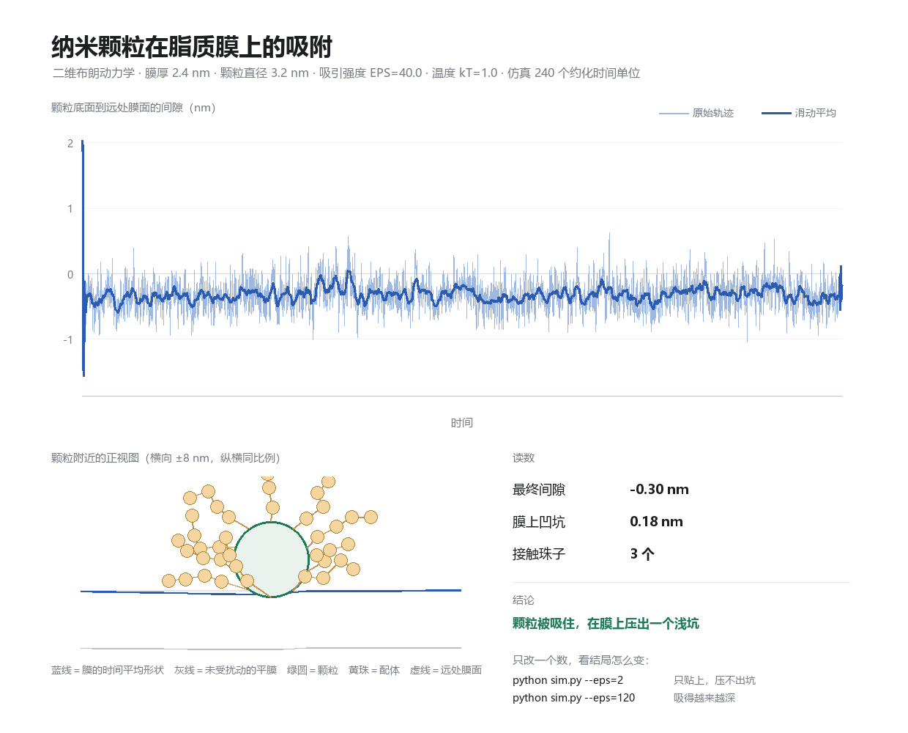

# nano-membrane-sim

从零开始写一个「纳米颗粒 + 脂质膜」的粗粒化模拟，最后用代理模型把参数扫描的成本降下来。

这里没有分子模拟软件，只有 numpy 和 PIL：**每一行都自己写，每一步都能解释**。

## 现在有什么

`30-mini-project/mini_sim/` —— 200 行二维布朗动力学。

```powershell
cd 30-mini-project/mini_sim
python sim.py
```

9 秒出图。算的是：一个纳米颗粒被吸引到脂质膜上，够不够力把膜压出一个坑。



三块图分别是：颗粒底面到膜面的间隙随时间、颗粒附近的正视图、以及一组读数。
旋钮就四个（`--eps` 吸引强度、`--ks` 膜的软硬、`--gap` 起始高度、`--steps` 步数），
改一个数就能看出结论怎么变。

## 目录

| 目录 | 放什么 | 状态 |
|---|---|---|
| `00-papers/` | 论文导读与笔记模板 | 三篇导读 |
| `10-md-basics/` | 分子动力学的概念笔记、环境搭建 | 未开始 |
| `20-ml-basics/` | numpy / GP / 主动学习的最小练习 | 未开始 |
| `30-mini-project/` | 小课题：计划书 + 代码 + 图 | v0 跑通 |
| `90-notes/` | 周志 | 持续 |

## 接下来

按 `30-mini-project/PROJECT.md` 走：把 v0 扩成「参数扫描 → 高斯过程代理 → 主动学习对照」，
目标是那张卖点图——同样 12 次模拟的预算下，主动学习比随机采样准多少。

## 约定

## 关于 AI 的使用（说明在前）

这个仓库里的代码和文字，是在 AI 辅助下完成的。这一点我不想含糊：

- **我能讲清楚的**：模型为什么这样设、每个参数代表什么、图里每根线在说什么、改哪个数会发生什么。
- **我还在补的**：数值方法里的取舍、代码逐行的实现细节、以及"为什么偏偏是这个写法"。这些目前只能算略懂皮毛，不能假装已经掌握。
- **我能担保的**：每一个数、每一张图，都是我自己在本机跑出来的，不是生成的示意图。跑不通的地方我也留在 README 里，没有藏起来。

把这些写明白，比假装全都懂要可靠。如果你发现问题，那大概率就是我还没吃透的那部分。

- 每周至少 commit 一次，message 写"做了什么"，不写 "update"。
- 笔记用中文写，但**术语保留英文原词**（coarse-graining、umbrella sampling），方便以后检索。
- 大文件（轨迹、结构、数据集）不进 git，见 `.gitignore`。
- 所有结论都要能指到一个文件、一张图或一行日志。没有证据的判断不写进笔记。
